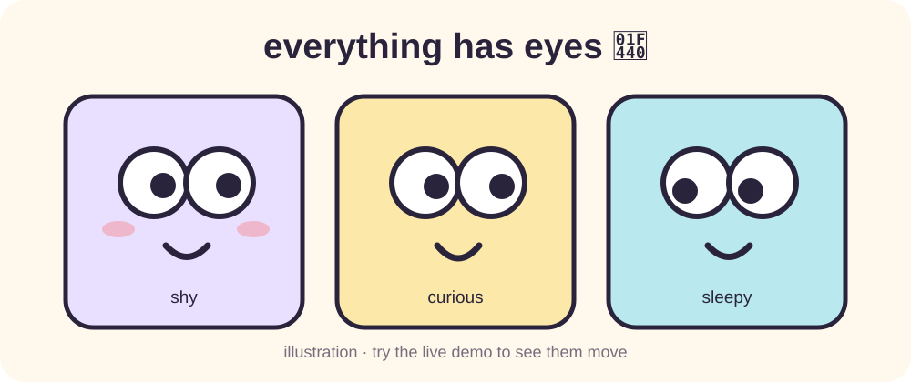

# Everything Has Eyes 👀

**Make the internet feel a little more alive.** A tiny, playful, open-source Chrome extension that gives ordinary webpage elements expressive googly eyes.

[**Try the interactive demo**](https://kaitlyn-xie-jj.github.io/everything-has-eyes/) · [**Installation guide**](#install) · [**Report a bug**](https://github.com/kaitlyn-xie-jj/everything-has-eyes/issues/new)

[](https://kaitlyn-xie-jj.github.io/everything-has-eyes/)

*Illustration of the characters; click to try the actual interactive demo.*

## What can these eyes do?

- **Follow your pointer** — buttons, links, images, inputs and other common webpage controls look at you.
- **Blink naturally** — independent, gentle blinks instead of synchronized jumps.
- **Get shy** — move your pointer too close and the eyes softly look away; retreat and they look back.
- **Get out of your way** — eyes never intercept clicks or typing. Click the extension again to remove them.

The demo deliberately gives three large cards oversized eyes to show the idea. On regular websites, the extension places smaller eyes on eligible elements and limits the initial selection to 70 visible elements.

## Try it first

**[Open the live demo →](https://kaitlyn-xie-jj.github.io/everything-has-eyes/)**

1. Click **Give everything eyes 👀**.
2. Move your pointer between the characters.
3. Move very close to a face to see the shy glance.
4. Click **Take the eyes away** to toggle the overlay off.

This demo uses the same `eyes.js` as the extension. It does not require installation, an account, or a backend.

## Install

This project is **not published on the Chrome Web Store yet**. For now, install from the source:

1. Download this repository using **Code → Download ZIP**, and unzip it.
2. In Chrome or another compatible Chromium browser, open `chrome://extensions`.
3. Enable **Developer mode** and select **Load unpacked**.
4. Select the extracted folder containing `manifest.json`.
5. Open a normal website, then click the **Everything Has Eyes** extension icon to add or remove the eyes.

Pin the extension from the browser's extensions menu to reach it easily.

**Limitations:** Browser internal pages, extension pages, some PDF viewers, and restricted sites do not permit script injection. Some custom widgets may not be detected. Only visible eligible elements are selected when the overlay is enabled; newly added elements may require toggling it off and on.

## Privacy & permissions

Everything Has Eyes is designed to run **entirely on your device**:

- No account, server, telemetry or analytics.
- No browsing history collection or network requests in the extension source.
- `activeTab` allows access to the current page **when you click the extension**; `scripting` injects the eyes overlay.
- The extension reads page layout and pointer coordinates to position the eyes; it does **not** read or store the text you type into form fields.

You can inspect all source files, including [`manifest.json`](manifest.json) and [`eyes.js`](eyes.js), before installing.

## Develop & test

Requires **Node.js 22+**. No `npm install` is needed.

```bash
npm run check
npm test
```

The automated suite covers eligible elements, pointer tracking, gentle independent blinking, shy gaze, toggling and cleanup, selection limits, the demo, and popup behaviour. [GitHub Actions](https://github.com/kaitlyn-xie-jj/everything-has-eyes/actions/workflows/tests.yml) runs syntax and unit tests on pushes and pull requests.

**Scope of verification:** Unit tests use lightweight DOM fixtures. They are not a substitute for installing the extension and verifying browser-specific behavior. The [demo deployment workflow](https://github.com/kaitlyn-xie-jj/everything-has-eyes/actions/workflows/deploy-demo.yml) publishes `index.html` and `eyes.js` to GitHub Pages.

## Contributing

Bug reports, small interaction ideas, accessible-design improvements and pull requests are welcome. If something looks odd on a particular webpage, please share the browser version, a reproducible URL (if public), and steps to reproduce. Do not post passwords, personal browsing information, or screenshots containing private content.

The design goal is **natural, lovable personalities without distracting users or breaking websites**. Keep changes lightweight and easy to disable.

## License

[MIT](LICENSE). Made for fun, not for tracking.
